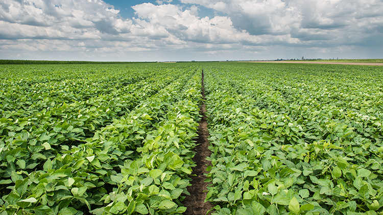

# 🌱 Crop Recommendation System — Machine Learning aplicado ao Agronegócio

  

**Fonte:** [JGB Soluções Ambientais — Rotação de culturas](https://www.jgbsolucoesambientais.com.br/post/rotação-de-culturas-exemplos)

## 📌 Sobre o projeto

Este projeto tem como objetivo desenvolver um modelo de Machine Learning capaz de recomendar culturas agrícolas a partir de características do solo e de condições climáticas.

A proposta é explorar como técnicas de Ciência de Dados podem contribuir para a análise de informações agrícolas e apoiar estudos relacionados à escolha de culturas.

O projeto foi desenvolvido em Python, utilizando técnicas de análise exploratória de dados, pré-processamento e algoritmos de classificação.

## 🎯 Objetivos

- Explorar dados relacionados às características do solo e do clima.
- Realizar análise exploratória de dados (EDA).
- Preparar os dados para aplicação de Machine Learning.
- Treinar e comparar diferentes modelos de classificação.
- Avaliar o desempenho dos modelos.
- Identificar as variáveis mais relevantes para as previsões.

## 📊 Sobre o dataset

Foi utilizado o **Crop Recommendation Dataset**, disponível no Kaggle.

O conjunto de dados possui:
- 2.200 registros;
- 8 colunas;
- 7 variáveis preditoras;
- 22 classes de culturas agrícolas;
- 100 registros por cultura.

### Variáveis utilizadas

| Variável | Descrição |
|---|---|
| N | Nitrogênio no solo |
| P | Fósforo no solo |
| K | Potássio no solo |
| temperature | Temperatura |
| humidity | Umidade |
| ph | pH do solo |
| rainfall | Precipitação |
| label | Cultura agrícola (variável alvo) |

**Fonte:** [Crop Recommendation Dataset — Kaggle](https://www.kaggle.com/datasets/atharvaingle/crop-recommendation-dataset)

## 🛠️ Tecnologias e bibliotecas

- Python
- Pandas
- NumPy
- Matplotlib
- Seaborn
- Scikit-learn
- Google Colab

## ⚙️ Etapas do desenvolvimento

### 1. Análise exploratória de dados (EDA)
- Inspeção inicial do dataset.
- Verificação de valores ausentes e duplicados.
- Análise da distribuição das culturas.
- Visualização das variáveis numéricas.
- Análise de correlação e distribuição por cultura.

### 2. Pré-processamento
- Separação das variáveis preditoras (X) e da variável alvo (y).
- Divisão dos dados em treinamento e teste.
- Utilização de `SimpleImputer` para tratamento de valores ausentes.
- Utilização de `StandardScaler` para padronização.
- Organização das etapas utilizando `Pipeline` do Scikit-learn.

A divisão foi realizada com 80% dos dados para treinamento e 20% para teste, utilizando estratificação das classes.

### 3. Modelagem

Foram utilizados dois algoritmos de classificação:

- **Decision Tree:** modelo baseado em regras de decisão organizadas em estrutura de árvore.
- **Random Forest:** conjunto de árvores de decisão que combina suas previsões para realizar a classificação.

### 4. Avaliação dos modelos

Foram utilizadas métricas como:

- Accuracy;
- Precision;
- Recall;
- F1-score;
- Matriz de confusão.

### 5. Importância das variáveis

Foi utilizada a técnica de `Permutation Importance` para investigar quais variáveis apresentam maior contribuição para o desempenho preditivo do modelo no conjunto de teste.

## 📈 Resultados

Os resultados dos modelos serão apresentados após a execução dos experimentos, permitindo comparar o desempenho da Decision Tree e da Random Forest.

**Modelo com melhor desempenho:** Random Forest

**Acurácia:** 0.995455

**Variável mais relevante:** humidity

## 💡 Aprendizados

Durante o desenvolvimento deste projeto, foram praticados conceitos importantes de Machine Learning:

- Análise e exploração de dados;
- Preparação de dados para modelagem;
- Divisão entre treino e teste;
- Construção de pipelines;
- Treinamento de modelos de classificação;
- Avaliação de desempenho;
- Interpretação da importância das variáveis.

## ⚠️ Limitações

Este projeto possui caráter educacional e utiliza um dataset específico para fins de aprendizado.

Os resultados representam padrões identificados pelo modelo nesse conjunto de dados e não constituem recomendações agronômicas validadas para aplicação direta em propriedades rurais.

## 🚀 Próximos passos

- Experimentar outros algoritmos de classificação.
- Realizar validação cruzada.
- Ajustar hiperparâmetros dos modelos.
- Aprofundar a interpretação das variáveis.
- Investigar o desempenho do modelo em dados externos.

## 👨‍💻 Autor

Desenvolvido como parte dos meus estudos em Ciência de Dados e Machine Learning, explorando aplicações de tecnologia no agronegócio.